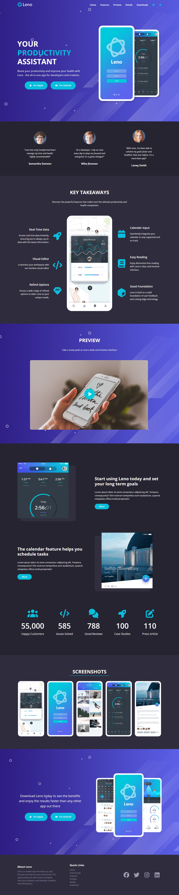
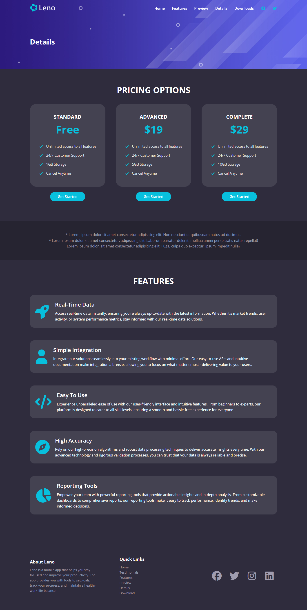
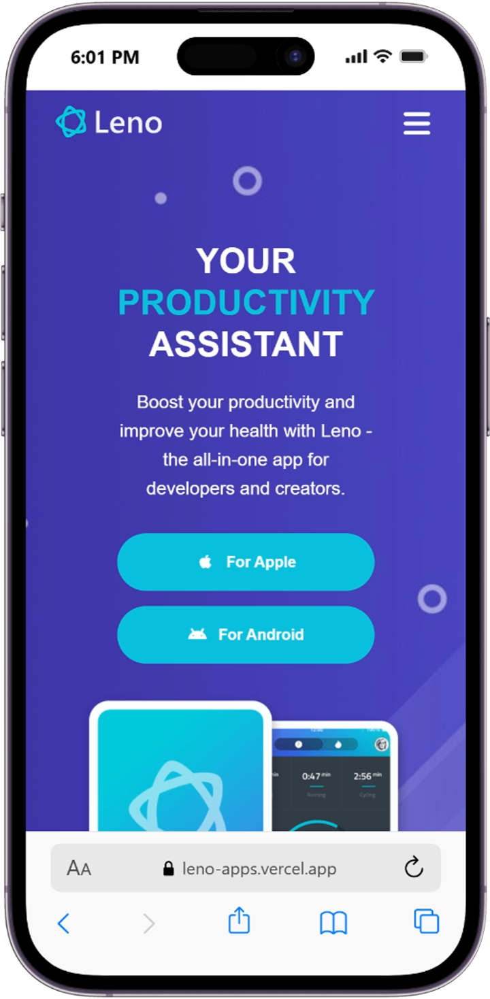

# 🚀 Leno — Health & Productivity Assistant App Landing Page

[](https://leno-apps.vercel.app/)
[](https://developer.mozilla.org/en-US/docs/Web/HTML)
[](https://developer.mozilla.org/en-US/docs/Web/CSS)
[](https://developer.mozilla.org/en-US/docs/Web/JavaScript)
[](LICENSE)

A modern, high-converting, and sleek landing page for **Leno** — the all-in-one productivity and health assistant mobile application tailored for creators, developers, and professionals.

🔗 **Live Website:** [https://leno-apps.vercel.app/](https://leno-apps.vercel.app/)  
📂 **GitHub Repository:** [https://github.com/sajidsam/LenoApps](https://github.com/sajidsam/LenoApps)

---

## 📸 Previews & Showcase

### 🖥️ Full Landing Page Preview
A comprehensive full-page showcase of the landing page featuring the hero section, dual smartphone mockups, key features, preview cards, testimonials, and download CTAs.



---

### 📄 Details Page Preview
Clean and structured details page highlighting in-depth project features, specifications, and application details.



---

### 📱 Mobile Responsive View (iPhone 14 Pro)
Fully optimized for mobile screens with a responsive slide-out hamburger navigation menu, fluid typography, and touch-friendly interface elements.

<p align="center">
  
</p>

---

## ✨ Features & Highlights

- 🎨 **Modern Gradient & Glassmorphism Aesthetic:** Premium dark violet/blue palette with vibrant turquoise highlights for an ultra-modern feel.
- 📱 **100% Fully Responsive Design:** Seamlessly adapts across mobile, tablet, and desktop viewports.
- 🍔 **Interactive Mobile Hamburger Menu:** Smooth animated slide navigation toggle for mobile users.
- 📜 **Sticky Dynamic Navbar:** Automatically alters styling on scroll with backdrop blur and shadow effect.
- 💬 **Customer Testimonials Cards:** Highlight user reviews and social proof with avatar cards.
- ⚡ **Pure Lightweight Code:** Built with zero bulky frameworks — fast loading speeds and optimal performance.
- 🏷️ **BEM Methodology:** Clean and scalable CSS class naming architecture.

---

## 🛠️ Built With

- **HTML5:** Semantic markup structure (BEM naming convention).
- **CSS3:** Custom properties (CSS variables), Flexbox, gradient overlays, media queries.
- **JavaScript (ES6):** DOM event listeners for scroll states and mobile drawer toggle.
- **Font Awesome 7:** Icons for social media, platforms (Apple, Android), and menu buttons.
- **Google Fonts:** Clean and accessible typography using *Open Sans*.
- **Vercel:** Cloud deployment and hosting.

---

## 📂 Project Structure

```bash
LenoApps/
├── css/
│   └── styles.css              # Main stylesheet with layout & responsive styles
├── images/                     # App screenshots, mockups, logos & testimonial assets
│   ├── logo.svg
│   ├── header-smartphones.png
│   ├── favicon.png
│   └── ...
├── js/
│   └── script.js               # Navbar scroll listener & mobile menu toggle logic
├── readme-images/              # Showcase screenshots
│   ├── screencapture-leno-apps-vercel-app-2026-10-27-01_30_19.png
│   ├── screencapture-leno-apps-vercel-app-details-2026-10-27-01_30_40.png
│   └── iPhone-14-PRO-leno-apps.vercel.app.png
├── details.html                # Details page markup
├── index.html                  # Main landing page markup
└── README.md                   # Project documentation
```

---

## 🚀 Getting Started

To run this project locally on your machine:

1. **Clone the repository:**
   ```bash
   git clone https://github.com/sajidsam/LenoApps.git
   ```

2. **Navigate into the project directory:**
   ```bash
   cd LenoApps
   ```

3. **Open the project:**
   - Double click `index.html` to open directly in your browser, or
   - Use VS Code **Live Server** extension (`Right click index.html -> Open with Live Server`).

---

## 👤 Author

- **Sajidul Islam**
  - GitHub: [@sajidsam](https://github.com/sajidsam)
  - Live Demo: [leno-apps.vercel.app](https://leno-apps.vercel.app/)

---

## 📄 License

This project is open source and available under the [MIT License](LICENSE).
